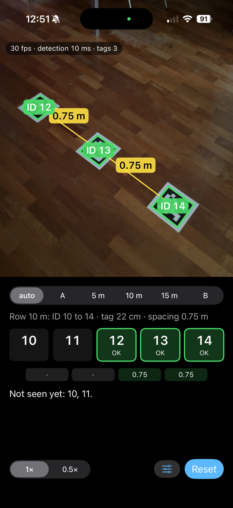
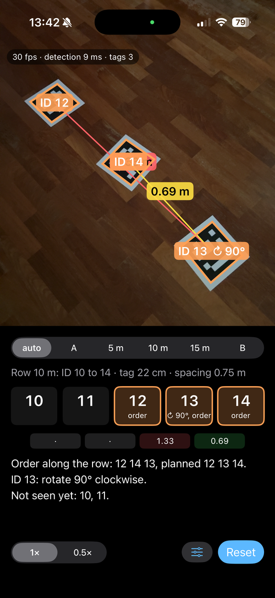

# apps/AriadneTags

Field tool used before each session to check the marker layout; it is not part of the measurement chain. Detection uses the AprilTag 3 C library (BSD 2-Clause, licence in `AprilTagKit/`). The Apple developer team identifier is left empty in the project: choose your own under Signing & Capabilities.

iPhone app for checking the field layout of AprilTag 36h11 markers: 5 rows of 5 tags, ID = 5 × row + position, position 0 on the left looking from A to B, the "ID nn" label towards B, 0.75 m centre spacing within a row, 22 cm tags.

Home test with the three tags of row 10 m (16 Oct 2026). Left: tags laid as planned, both spacings 0.75 m, all three OK. Right: tags 13 and 14 swapped and tag 13 rotated; the app reports the order along the row (12 14 13 instead of 12 13 14) and the rotation needed for tag 13 (90° clockwise).

## Running it

Requirements: a Mac with Xcode 16 or later, an iPhone with iOS 17 or later, USB cable or Wi‑Fi pairing.

1. Open `AriadneTags.xcodeproj`.
2. Project AriadneTags › target AriadneTags › Signing & Capabilities: choose your Apple ID under Team (Add Account if it is not there).
3. If Xcode reports that the identifier `pl.generatywnie.ariadne.tags` is taken, change it to any other, e.g. with `.filip` appended.
4. Select your iPhone as the run destination and run (⌘R).
5. First run on the iPhone: Settings › General › VPN & Device Management › trust the developer certificate. Developer Mode must also be on (Settings › Privacy & Security).

With a free Apple ID the app runs for 7 days; after that, run it again from Xcode.

The scheme runs the Release build, because the C detector is several times slower without optimisation.

## Use in the field

1. Hold the phone screen up, camera down, about 1.2 to 1.5 m above the tags, long side along the row.
2. Walk along the row, or with the 0.5× lens cover the whole row in one frame.
3. The row is picked from the first tag seen. It can also be chosen at the top of the panel.
4. A short vibration confirms every new tag of the row.

On the preview:

- green outline: tag of the current row, no issues;
- orange outline: tag of the current row with an issue; a rotation hint (↻ 90°, ↺ 90°, 180°) is shown next to the ID;
- red outline: tag that does not belong to the current row;
- yellow line with a number: spacing between neighbouring tags in metres, measured from the image. Each tag's edges give the local scale, so phone height, tilt and camera calibration do not matter. A red line means the spacing differs from the plan by more than 15 %.

The panel below the preview shows the five IDs of the row, the spacing between neighbours (median of recent frames) and a list of issues:

- a tag from another row, and the row it belongs to;
- order along the row different from the plan;
- a tag that needs rotating, with direction and angle (clockwise as seen from above);
- all visible tags rotated 180° relative to the ID order;
- spacing outside tolerance;
- tags not seen yet.

Every check uses only the last 20 frames, so a correction shows up within about half a second. "Reset" clears the results for the current row.

The plan button (sliders icon) sets the tag size (16 cm A4 sheets or 22 cm boards) and the spacing. The tag size must match the print, because it is the scale for all distances.

## Structure

- `AriadneTags/`: SwiftUI app (AVFoundation camera, detection on the luma plane at 1920 × 1080, preview with overlay).
- `AprilTagKit/`: local Swift package. `CAprilTag` is the AprilTag 3 C library (AprilRobotics/apriltag, BSD 2‑Clause licence, `LICENSE-apriltag.md`), tag36h11 family only. `AprilTagKit` holds the Swift wrapper (`TagDetector`) and the row check (`FieldPlan`, `RowCheck`).

Plan defaults are in `FieldPlan` (`AprilTagKit/Sources/AprilTagKit/RowCheck.swift`): number of rows, tags per row, spacing, tag size.

Detector: `quad_decimate` 2, 4 threads, `refine_edges`, `decode_sharpening` 0.25, up to 2 corrected bits, detections with decision margin below 20 rejected.

## Files

| File | Title |
|---|---|
| [`AprilTagKit/LICENSE-apriltag.md`](AprilTagKit/LICENSE-apriltag.md) |  |
| [`AprilTagKit/Package.swift`](AprilTagKit/Package.swift) |  |
| [`AprilTagKit/Sources/AprilTagKit/RowCheck.swift`](AprilTagKit/Sources/AprilTagKit/RowCheck.swift) |  |
| [`AprilTagKit/Sources/AprilTagKit/TagDetector.swift`](AprilTagKit/Sources/AprilTagKit/TagDetector.swift) |  |
| [`AprilTagKit/Sources/CAprilTag/apriltag.c`](AprilTagKit/Sources/CAprilTag/apriltag.c) |  |
| [`AprilTagKit/Sources/CAprilTag/apriltag_quad_thresh.c`](AprilTagKit/Sources/CAprilTag/apriltag_quad_thresh.c) |  |
| [`AprilTagKit/Sources/CAprilTag/common/g2d.c`](AprilTagKit/Sources/CAprilTag/common/g2d.c) |  |
| [`AprilTagKit/Sources/CAprilTag/common/homography.c`](AprilTagKit/Sources/CAprilTag/common/homography.c) |  |
| [`AprilTagKit/Sources/CAprilTag/common/image_u8.c`](AprilTagKit/Sources/CAprilTag/common/image_u8.c) |  |
| [`AprilTagKit/Sources/CAprilTag/common/image_u8_parallel.c`](AprilTagKit/Sources/CAprilTag/common/image_u8_parallel.c) |  |
| [`AprilTagKit/Sources/CAprilTag/common/image_u8x3.c`](AprilTagKit/Sources/CAprilTag/common/image_u8x3.c) |  |
| [`AprilTagKit/Sources/CAprilTag/common/image_u8x4.c`](AprilTagKit/Sources/CAprilTag/common/image_u8x4.c) |  |
| [`AprilTagKit/Sources/CAprilTag/common/matd.c`](AprilTagKit/Sources/CAprilTag/common/matd.c) |  |
| [`AprilTagKit/Sources/CAprilTag/common/pam.c`](AprilTagKit/Sources/CAprilTag/common/pam.c) |  |
| [`AprilTagKit/Sources/CAprilTag/common/pjpeg-idct.c`](AprilTagKit/Sources/CAprilTag/common/pjpeg-idct.c) |  |
| [`AprilTagKit/Sources/CAprilTag/common/pjpeg.c`](AprilTagKit/Sources/CAprilTag/common/pjpeg.c) |  |
| [`AprilTagKit/Sources/CAprilTag/common/pnm.c`](AprilTagKit/Sources/CAprilTag/common/pnm.c) |  |
| [`AprilTagKit/Sources/CAprilTag/common/pthreads_cross.c`](AprilTagKit/Sources/CAprilTag/common/pthreads_cross.c) |  |
| [`AprilTagKit/Sources/CAprilTag/common/string_util.c`](AprilTagKit/Sources/CAprilTag/common/string_util.c) |  |
| [`AprilTagKit/Sources/CAprilTag/common/svd22.c`](AprilTagKit/Sources/CAprilTag/common/svd22.c) |  |
| [`AprilTagKit/Sources/CAprilTag/common/time_util.c`](AprilTagKit/Sources/CAprilTag/common/time_util.c) |  |
| [`AprilTagKit/Sources/CAprilTag/common/unionfind.c`](AprilTagKit/Sources/CAprilTag/common/unionfind.c) |  |
| [`AprilTagKit/Sources/CAprilTag/common/workerpool.c`](AprilTagKit/Sources/CAprilTag/common/workerpool.c) |  |
| [`AprilTagKit/Sources/CAprilTag/common/zarray.c`](AprilTagKit/Sources/CAprilTag/common/zarray.c) |  |
| [`AprilTagKit/Sources/CAprilTag/common/zhash.c`](AprilTagKit/Sources/CAprilTag/common/zhash.c) |  |
| [`AprilTagKit/Sources/CAprilTag/common/zmaxheap.c`](AprilTagKit/Sources/CAprilTag/common/zmaxheap.c) |  |
| [`AprilTagKit/Sources/CAprilTag/headers/apriltag.h`](AprilTagKit/Sources/CAprilTag/headers/apriltag.h) |  |
| [`AprilTagKit/Sources/CAprilTag/headers/apriltag_math.h`](AprilTagKit/Sources/CAprilTag/headers/apriltag_math.h) |  |
| [`AprilTagKit/Sources/CAprilTag/headers/common/debug_print.h`](AprilTagKit/Sources/CAprilTag/headers/common/debug_print.h) |  |
| [`AprilTagKit/Sources/CAprilTag/headers/common/doubles.h`](AprilTagKit/Sources/CAprilTag/headers/common/doubles.h) |  |
| [`AprilTagKit/Sources/CAprilTag/headers/common/doubles_floats_impl.h`](AprilTagKit/Sources/CAprilTag/headers/common/doubles_floats_impl.h) |  |
| [`AprilTagKit/Sources/CAprilTag/headers/common/floats.h`](AprilTagKit/Sources/CAprilTag/headers/common/floats.h) |  |
| [`AprilTagKit/Sources/CAprilTag/headers/common/g2d.h`](AprilTagKit/Sources/CAprilTag/headers/common/g2d.h) |  |
| [`AprilTagKit/Sources/CAprilTag/headers/common/getopt.h`](AprilTagKit/Sources/CAprilTag/headers/common/getopt.h) |  |
| [`AprilTagKit/Sources/CAprilTag/headers/common/homography.h`](AprilTagKit/Sources/CAprilTag/headers/common/homography.h) |  |
| [`AprilTagKit/Sources/CAprilTag/headers/common/image_types.h`](AprilTagKit/Sources/CAprilTag/headers/common/image_types.h) |  |
| [`AprilTagKit/Sources/CAprilTag/headers/common/image_u8.h`](AprilTagKit/Sources/CAprilTag/headers/common/image_u8.h) |  |
| [`AprilTagKit/Sources/CAprilTag/headers/common/image_u8_parallel.h`](AprilTagKit/Sources/CAprilTag/headers/common/image_u8_parallel.h) |  |
| [`AprilTagKit/Sources/CAprilTag/headers/common/image_u8x3.h`](AprilTagKit/Sources/CAprilTag/headers/common/image_u8x3.h) |  |
| [`AprilTagKit/Sources/CAprilTag/headers/common/image_u8x4.h`](AprilTagKit/Sources/CAprilTag/headers/common/image_u8x4.h) |  |
| [`AprilTagKit/Sources/CAprilTag/headers/common/matd.h`](AprilTagKit/Sources/CAprilTag/headers/common/matd.h) |  |
| [`AprilTagKit/Sources/CAprilTag/headers/common/math_util.h`](AprilTagKit/Sources/CAprilTag/headers/common/math_util.h) |  |
| [`AprilTagKit/Sources/CAprilTag/headers/common/pam.h`](AprilTagKit/Sources/CAprilTag/headers/common/pam.h) |  |
| [`AprilTagKit/Sources/CAprilTag/headers/common/pjpeg.h`](AprilTagKit/Sources/CAprilTag/headers/common/pjpeg.h) |  |
| [`AprilTagKit/Sources/CAprilTag/headers/common/pnm.h`](AprilTagKit/Sources/CAprilTag/headers/common/pnm.h) |  |
| [`AprilTagKit/Sources/CAprilTag/headers/common/postscript_utils.h`](AprilTagKit/Sources/CAprilTag/headers/common/postscript_utils.h) |  |
| [`AprilTagKit/Sources/CAprilTag/headers/common/pthreads_cross.h`](AprilTagKit/Sources/CAprilTag/headers/common/pthreads_cross.h) |  |
| [`AprilTagKit/Sources/CAprilTag/headers/common/string_util.h`](AprilTagKit/Sources/CAprilTag/headers/common/string_util.h) |  |
| [`AprilTagKit/Sources/CAprilTag/headers/common/svd22.h`](AprilTagKit/Sources/CAprilTag/headers/common/svd22.h) |  |
| [`AprilTagKit/Sources/CAprilTag/headers/common/time_util.h`](AprilTagKit/Sources/CAprilTag/headers/common/time_util.h) |  |
| [`AprilTagKit/Sources/CAprilTag/headers/common/timeprofile.h`](AprilTagKit/Sources/CAprilTag/headers/common/timeprofile.h) |  |
| [`AprilTagKit/Sources/CAprilTag/headers/common/unionfind.h`](AprilTagKit/Sources/CAprilTag/headers/common/unionfind.h) |  |
| [`AprilTagKit/Sources/CAprilTag/headers/common/workerpool.h`](AprilTagKit/Sources/CAprilTag/headers/common/workerpool.h) |  |
| [`AprilTagKit/Sources/CAprilTag/headers/common/zarray.h`](AprilTagKit/Sources/CAprilTag/headers/common/zarray.h) |  |
| [`AprilTagKit/Sources/CAprilTag/headers/common/zhash.h`](AprilTagKit/Sources/CAprilTag/headers/common/zhash.h) |  |
| [`AprilTagKit/Sources/CAprilTag/headers/common/zmaxheap.h`](AprilTagKit/Sources/CAprilTag/headers/common/zmaxheap.h) |  |
| [`AprilTagKit/Sources/CAprilTag/headers/tag36h11.h`](AprilTagKit/Sources/CAprilTag/headers/tag36h11.h) |  |
| [`AprilTagKit/Sources/CAprilTag/include/CAprilTag.h`](AprilTagKit/Sources/CAprilTag/include/CAprilTag.h) |  |
| [`AprilTagKit/Sources/CAprilTag/tag36h11.c`](AprilTagKit/Sources/CAprilTag/tag36h11.c) |  |
| [`AriadneTags.xcodeproj/project.pbxproj`](AriadneTags.xcodeproj/project.pbxproj) |  |
| [`AriadneTags.xcodeproj/project.xcworkspace/contents.xcworkspacedata`](AriadneTags.xcodeproj/project.xcworkspace/contents.xcworkspacedata) |  |
| [`AriadneTags.xcodeproj/xcshareddata/xcschemes/AriadneTags.xcscheme`](AriadneTags.xcodeproj/xcshareddata/xcschemes/AriadneTags.xcscheme) |  |
| [`AriadneTags/AriadneTagsApp.swift`](AriadneTags/AriadneTagsApp.swift) |  |
| [`AriadneTags/CameraModel.swift`](AriadneTags/CameraModel.swift) |  |
| [`AriadneTags/CameraPreview.swift`](AriadneTags/CameraPreview.swift) |  |
| [`AriadneTags/ContentView.swift`](AriadneTags/ContentView.swift) |  |
| [`docs/screenshot_row_issues.png`](docs/screenshot_row_issues.png) |  |
| [`docs/screenshot_row_ok.png`](docs/screenshot_row_ok.png) |  |
